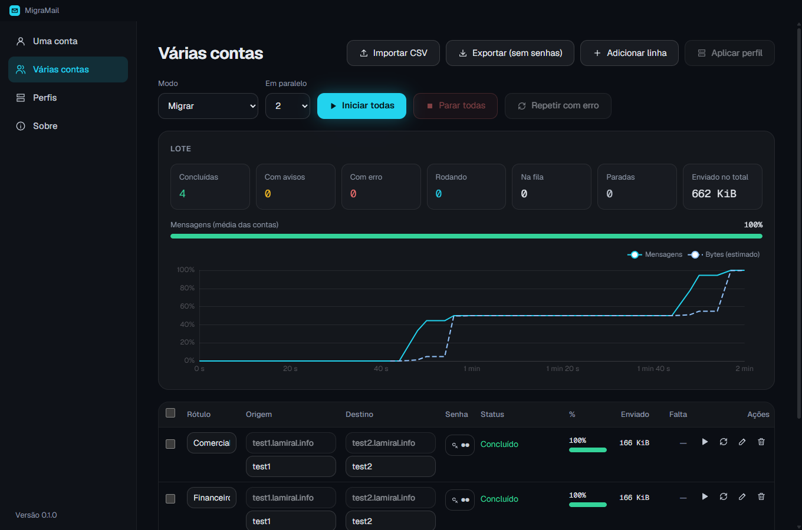
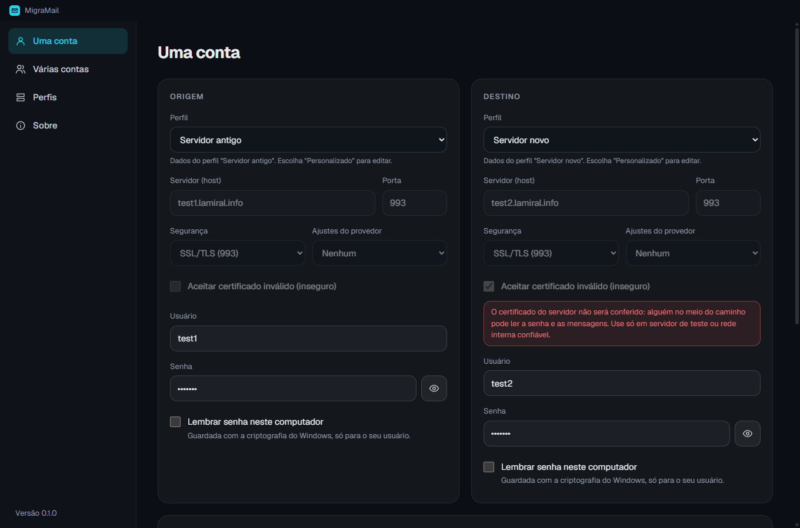
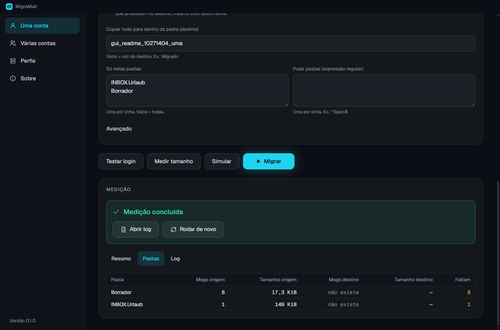
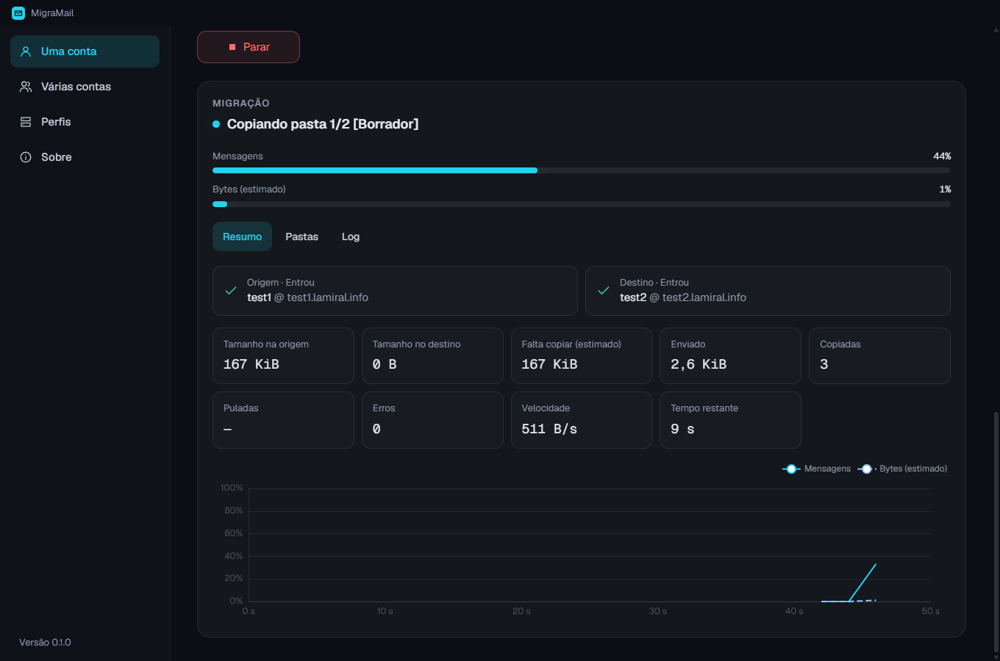
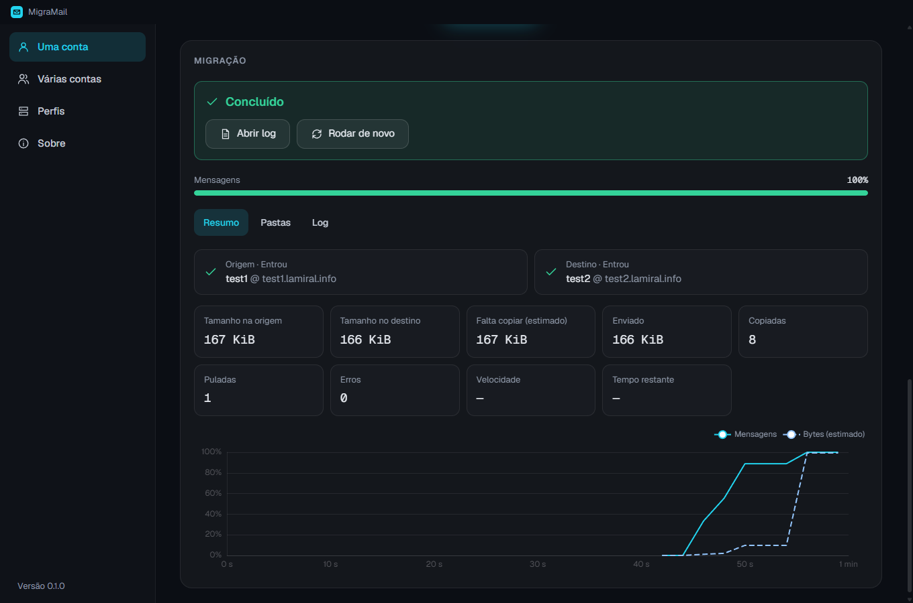
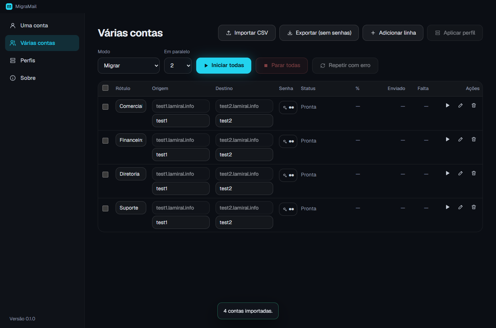
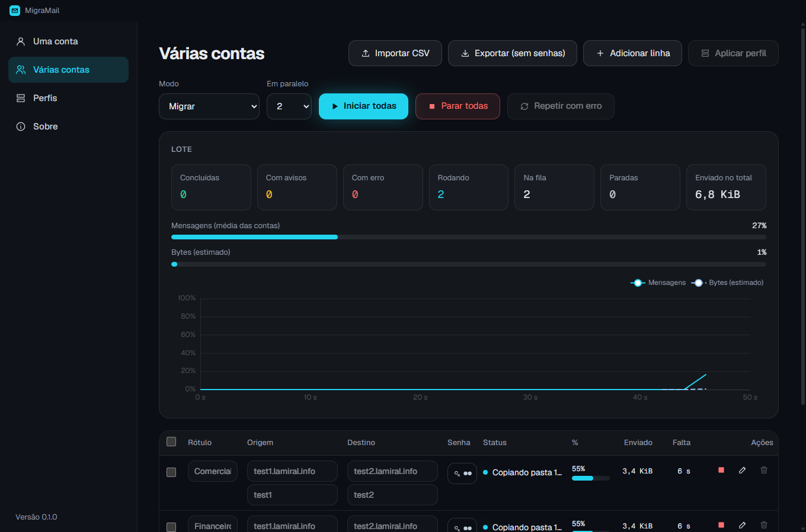
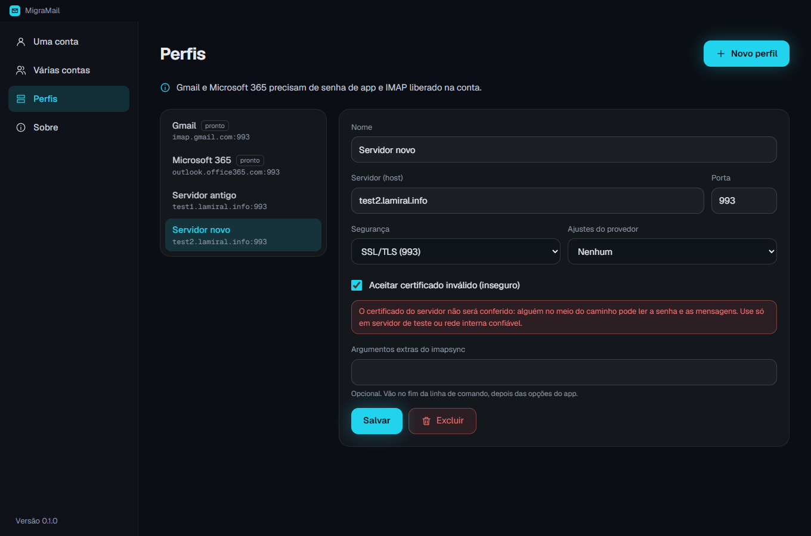
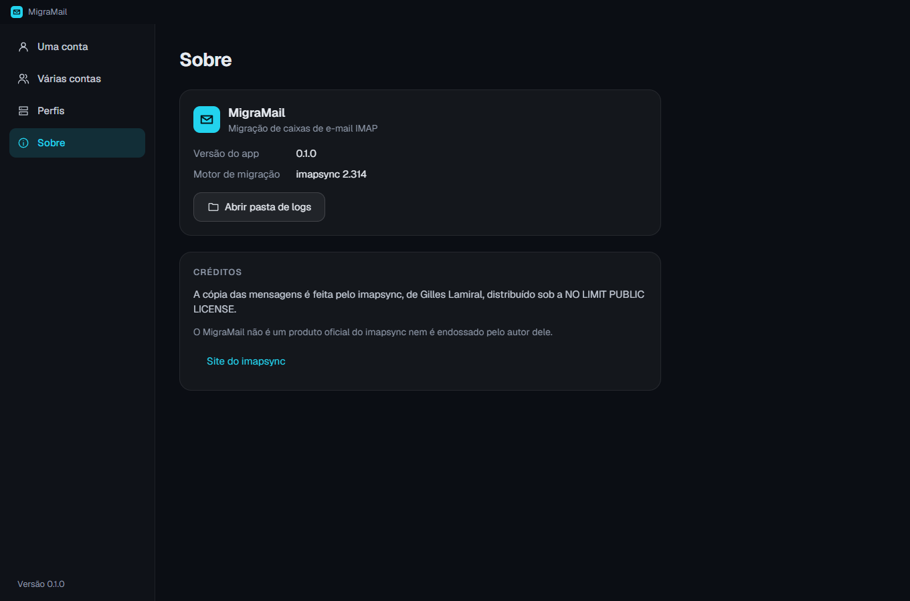

# MigraMail

Migra caixas de e-mail de um servidor IMAP para outro no Windows, com interface gráfica. Uma conta por vez ou várias em paralelo (importando um CSV), mostrando o tamanho das pastas, o andamento ao vivo e um gráfico da porcentagem já enviada. Por baixo roda o [imapsync](https://imapsync.lamiral.info) 2.314, que vai junto do programa.

[](https://github.com/brunokdalcastel/migramail/releases/latest/download/MigraMail-Setup.exe)

Enquanto o repositório estiver privado, o download exige acesso autorizado no GitHub.

Os prints abaixo usam as contas públicas de teste do imapsync (`test1`/`test2.lamiral.info`).



## Instalação

1. Baixe o [`MigraMail-Setup.exe`](https://github.com/brunokdalcastel/migramail/releases/latest/download/MigraMail-Setup.exe) (ou veja todas as versões nas [Releases](https://github.com/brunokdalcastel/migramail/releases)).
2. Execute. O instalador é por usuário: não pede administrador e instala em `%LOCALAPPDATA%\Programs\MigraMail`.
3. Abra pelo atalho da área de trabalho ou do menu Iniciar.

Requisitos: Windows 10 (2004) ou mais novo, 64 bits.

### Antivírus e SmartScreen

O instalador e o `imapsync.exe` não são assinados digitalmente. Na primeira vez o SmartScreen pode avisar "O Windows protegeu o computador": clique em **Mais informações → Executar assim mesmo**.

O `imapsync.exe` é um programa Perl empacotado: a cada execução ele extrai cerca de 35 MB em `%TEMP%\par-<usuário>` e o antivírus examina esses arquivos. Por isso **toda migração leva uns 30 segundos para começar**, mesmo um "Testar login". É normal; o MigraMail apaga essa pasta ao fim de cada execução.

## Como usar

### Uma conta



1. Em **Origem**, informe o servidor de onde os e-mails saem: host, porta, segurança (SSL/TLS na 993 é o mais comum), usuário e senha. Se já tiver um perfil salvo, escolha em **Perfil** e só preencha usuário e senha.
2. Em **Destino**, o mesmo para o servidor para onde os e-mails vão.
3. Em **Opções** (todas opcionais):
   - Por padrão a estrutura é copiada **exatamente como está**: uma pasta `teste` na origem vira `teste` no destino, `Sent` continua `Sent`, e as subpastas vêm junto.
   - **Juntar pastas especiais com as do destino** (desligado por padrão): Enviados, Lixeira e Rascunhos caem nas pastas equivalentes que já existem no destino, mesmo com nome diferente (ex.: `Sent` → `Itens Enviados`), em vez de criar pastas novas.
   - **Copiar tudo para dentro da pasta**: põe a migração numa subpasta do destino (ex.: `Migrado`), sem misturar com o que já existe lá.
   - **Só estas pastas** / **Pular pastas**: escolhe o que migrar.
   - **Avançado**: limite de velocidade, máximo de erros e argumentos extras do imapsync.
4. Use os botões na ordem:
   - **Testar login**: confere usuário e senha nos dois servidores, sem copiar nada.
   - **Medir tamanho**: mostra quantas mensagens e quanto espaço cada pasta ocupa na origem e no destino.
   - **Simular**: roda a migração sem gravar nada (`--dry`), para ver o que seria copiado.
   - **Migrar**: copia de verdade (pede confirmação). Nada é apagado da origem.



Durante a migração aparecem a pasta atual, a porcentagem por mensagens e por bytes, o que já foi enviado, a velocidade, o tempo restante e o gráfico da porcentagem ao longo do tempo. As abas **Pastas** e **Log** mostram o detalhe e a saída do imapsync ao vivo. **Parar** interrompe; **Rodar de novo** continua de onde parou, porque o que já está no destino é pulado.





Lembre que cada execução leva uns 30 segundos para começar (ver [Antivírus e SmartScreen](#antivírus-e-smartscreen)).

### Várias contas



1. Clique em **Importar CSV** (ou arraste o arquivo para a tela). Aceita:
   - CSV com cabeçalho `host1,user1,password1,host2,user2,password2,extra` (a coluna `extra` leva argumentos do imapsync para aquela conta, ex.: `--subfolder2 Migrado`);
   - o `file.txt` do imapsync, separado por `;`.
     O host pode vir como `host:porta`. Um servidor que bate com um perfil salvo recebe as configurações do perfil.
2. Confira a tabela: dá para editar host, usuário e rótulo direto na linha, adicionar linhas, aplicar um perfil às linhas selecionadas e informar as senhas que faltam (ícone da chave).
3. Escolha o **Modo** (Testar login, Medir tamanho, Simular ou Migrar) e quantas contas rodam **Em paralelo** (1 a 5). As outras esperam na fila.
4. **Iniciar todas**. O painel acima da tabela mostra o total do lote; cada linha mostra o status, a % e o tempo restante da conta. Clique numa linha para ver os detalhes dela.
5. No fim, **Repetir com erro** roda de novo só as contas que falharam (corrija a senha antes, se for o caso). **Exportar** salva a lista sem as senhas.




Dica: não ponha mais de 2 ou 3 contas em paralelo no mesmo servidor; muitos provedores limitam conexões simultâneas e o app avisa quando isso acontece.

### Perfis



Um perfil guarda host, porta, segurança, os ajustes do provedor e argumentos extras de um servidor, para não digitar de novo. **Gmail** e **Microsoft 365** já vêm prontos (somente leitura; use **Duplicar** para mudar). Uma conta presa a um perfil acompanha as mudanças dele.

### Sobre



Versão do app e do imapsync, créditos e o botão **Abrir pasta de logs**.

### Exemplo: de outro painel para a KingHost

1. Crie um perfil **KingHost**: host `imap.kinghost.net`, porta `993`, segurança SSL/TLS (contas de revenda usam `imap.uni5.net`). Faça um perfil também para o servidor antigo (no cPanel/Plesk costuma ser `mail.<domínio>` na 993).
2. Em **Uma conta**, escolha os dois perfis e use o e-mail completo como usuário nos dois lados. Se a conta KingHost tiver verificação em duas etapas, use uma senha de aplicativo.
3. **Testar login** e depois **Medir tamanho**. A aba **Pastas** lista as pastas da origem e mostra "não existe" nas que ainda não estão na KingHost. Se as pastas especiais da origem aparecem como "não existe" e o webmail da KingHost já tem as dela com outro nome (ex.: `Sent` × `Enviados`), decida:
   - deixar **"Juntar pastas especiais"** desligado: copia exatamente como está, e a KingHost fica com as duas pastas (`Sent` com as mensagens antigas e a dela);
   - ligar: as mensagens enviadas antigas entram na pasta de enviados da KingHost.
4. **Simular** e, se estiver certo, **Migrar**. Rodar de novo depois (por exemplo, no dia da troca do MX) só copia o que chegou nesse meio-tempo.

### Gmail e Microsoft 365

Use uma **senha de app**, não a senha normal da conta:

- Gmail: ative a verificação em duas etapas e crie a senha em [myaccount.google.com/apppasswords](https://myaccount.google.com/apppasswords). O IMAP precisa estar ligado nas configurações do Gmail.
- Microsoft 365: o IMAP com senha precisa estar liberado para a conta pelo administrador do tenant; muitos tenants só aceitam OAuth2, que o MigraMail não suporta.

## Senhas

As senhas vão ao imapsync por variável de ambiente, nunca pela linha de comando. Os argumentos extras aceitam apenas uma lista de opções de dados com nomes completos. Comandos, tokens OAuth, arquivos de senha, depuração, exclusões e alterações de servidor ou modo são recusados, inclusive no CSV. "Lembrar senha" guarda a senha cifrada pelo Windows (DPAPI, só o seu usuário consegue abrir). Senhas do modo "Várias contas" ficam só na memória até você marcar "lembrar".

## Onde ficam os dados e os logs

- Configurações, perfis e contas salvas: `%APPDATA%\MigraMail`.
- Log de cada migração (a saída completa do imapsync): `%APPDATA%\MigraMail\logs`. Abra pelo botão **Abrir log** do job ou por **Sobre → Abrir pasta de logs**.

Desinstalar o app não apaga essa pasta.

## Créditos

A migração é feita pelo imapsync, de Gilles Lamiral, sob a NO LIMIT PUBLIC LICENSE. O MigraMail não é um produto oficial do imapsync. Detalhes em [`NOTICE`](NOTICE) e [`THIRD_PARTY_LICENSES.md`](THIRD_PARTY_LICENSES.md).

## Para desenvolver

```
npm install
npm run fetch-imapsync   # baixa o imapsync.exe 2.314 para vendor/imapsync (confere o SHA-256)
npm run dev
npm test
npm run dist             # gera dist/MigraMail-Setup-<versão>.exe
npm run release          # publica a Release (precisa de RELEASE.md e árvore limpa)
npm run screenshots      # refaz os prints de docs/img (migra de verdade test1 → test2, ~6 min)
```

Sem internet: `npm run fetch-imapsync -- --from C:\Tools\imapsync\imapsync_2.314`. O fluxo do projeto (PRD → Spec → fases) está em `docs/`.

### Argumentos extras permitidos

Opções com texto: `--subfolder2`, `--folder`, `--folderrec`, `--folderfirst`, `--folderlast`, `--exclude`, `--f1f2`. Use aspas duplas para espaços. Valores não podem começar com traço ou `+`.

Opções com inteiro positivo: `--maxlinelength`, `--maxsize`, `--minsize`, `--maxage`, `--minage`, `--maxbytespersecond`, `--errorsmax`.

Sem valor: `--nofoldersizes`, `--foldersizes`, `--automap`, `--noautomap`, `--justfolders`, `--syncinternaldates`, `--nosyncinternaldates`, `--useuid`, `--nosyncflags`, `--noresyncflags`, `--noshowpasswords`, `--nodebugenv`. Abreviações e opções desconhecidas são recusadas. Ajuste o modo e os servidores pelos campos da interface. OAuth por argumentos extras não é suportado.

## Licença

O código do MigraMail é distribuído sob a [licença MIT](LICENSE). Componentes de terceiros mantêm suas próprias licenças, descritas em NOTICE e THIRD_PARTY_LICENSES.md.

### Diagnosticar paralelismo

`npx tsx --tsconfig tsconfig.node.json scripts/diagnose-parallel.ts` inicia dois testes de login simultâneos nas contas públicas do imapsync, sem copiar nem apagar mensagens. Requer o motor baixado. Salva horários e resultado em `../parallel-diagnostic` (ou `MIGRAMAIL_DIAGNOSTIC_DIR`). O destino de demonstração usa a exceção de certificado já documentada; as contas de produção mantêm a validação por padrão.
